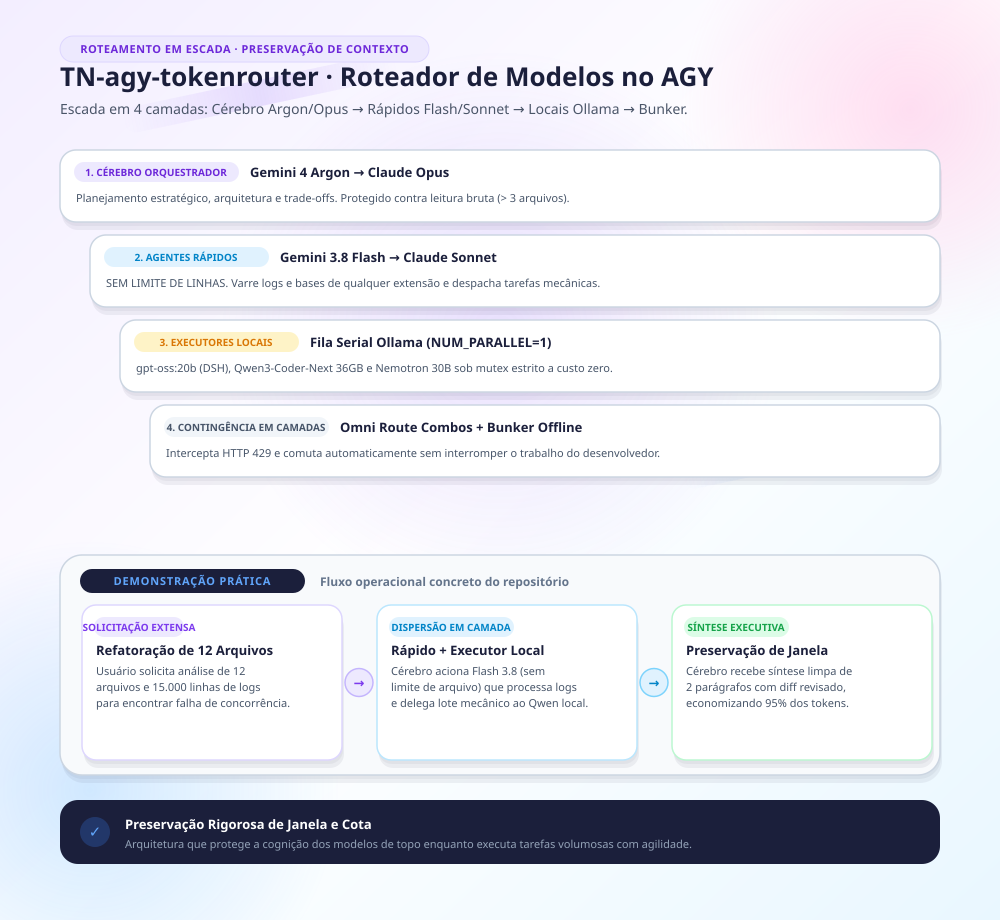

# TN-agy-tokenrouter (v2.2.0) — Roteador de Modelos em Escada para o Antigravity

> **Roteador inteligente em escada e preservação estrita de contexto para o Google Antigravity (AGY): Cérebro Orquestrador (Argon → Opus), Agentes Rápidos de leitura ilimitada (Flash 3.8 → Sonnet) e Executores Locais Ollama a custo zero.**


*Para visualização técnica complementar em diagrama de blocos com paleta Okabe-Ito, veja o [Diagrama Técnico](docs/roteamento-tokens-agy.png) ou o arquivo vetorial [SVG](docs/roteamento-tokens-agy.svg).*

---

## 🏛️ 1. Arquitetura Operacional: Analisar e Distribuir

> **Diretriz Soberana:** Não há camada ou filtro automático de restrição. O usuário decide com exclusividade o que é inserido ou não na sessão de trabalho. O papel do agente no AGY é puramente **analisar a solicitação e distribuir a execução entre as camadas técnicas mais eficientes**.

### 1. Camada 1 — Cérebro Orquestrador (em Escada: `ARGON` → `OPUS`)
- **1º Degrau:** **`Gemini 4 Argon`** (modelo principal no AGY)
- **2º Degrau:** **`Claude Opus`** (`Opus 5.5` / `Opus`)
- **Papel Exclusivo:** Planejamento estratégico (`implementation_plan.md`), decisões de arquitetura e trade-offs, redação de entrega final, síntese de alto nível, edição direta pontual (até 2 arquivos) e **comando de distribuição para os agentes rápidos e modelos locais**.
- **Proteção da Janela Principal:** O Cérebro nunca lê > 3 arquivos brutos nem despeja saídas volumosas de logs diretamente na sua própria janela.

### 2. Camada 2 — Agentes Rápidos (em Escada: `Flash 3.8` → `Sonnet`)
- **1º Degrau:** **`Gemini 3.8 Flash`** (`Model: "flash"` via `invoke_subagent`)
- **2º Degrau:** **`Claude Sonnet`** (`Sonnet 5.5` / `Sonnet`)
- **Sem Limite de Tamanho de Arquivo:** Os Agentes Rápidos (`Flash 3.8` e `Sonnet`) **NÃO têm limite de tamanho de arquivo ou número de linhas**. Processam arquivos, logs, CSVs e códigos de qualquer extensão em seus contextos isolados e devolvem ao Cérebro apenas uma **síntese executiva limpa de 1 a 3 parágrafos**.
- **Despacho aos Modelos Locais (sob comando do Cérebro):** Os Agentes Rápidos **podem despachar subtarefas diretamente aos modelos locais do Ollama (Camada 3)** (`dsh-local`, `qwen-local`, `opencode-local`, MCP `ollama-router`), quando o Cérebro demandar essa distribuição mecânica.

### 3. Camada 3 — Executores Locais Ollama (Custo Zero de Crédito)
Acionados diretamente pelo Cérebro ou distribuídos pelos Agentes Rápidos sob demanda do Cérebro:
- **`dsh-local` (DeepSeek Harness — `gpt-oss:20b`):** 1 a 4 arquivos (~70 s), código mecânico e revisão de 2ª família local.
- **`qwen-local` (Qwen Code — `Qwen3-Coder-Next :NOTPL`, ~36 GB):** lote mecânico grande (≥ 5 arquivos num único prompt, piso 2–4 min, sem fatiar).
- **`opencode-local` (OpenCode, agente `investigador` — `nemotron-3.5-lightning:30b-a3b`) + `LightRAG`:** consultas e buscas semânticas locais.
- **MCP `ollama-router` (`qwen3-coder:30b` / `qwen2.5-coder:7b`):** `ollama_refactor`, `ollama_code_review` e `ollama_worker_task`.
- **Gate Obrigatório de Consolidação:** Todo trabalho de modelo local é **não revisado por definição** e é auditado antes de integrar.

### 4. Camada 4 — Contingência Automática
- **Plano A:** OmniRoute + compressão RTK em caso de `HTTP 429`.
- **Plano B:** Bunker 100% offline via MCP `ollama-router` / `claude-local`.

---

## 📊 2. Matriz de Distribuição Técnica

| Demanda Recebida | Camada Responsável | Modelo Utilizado | Regra de Execução / Saída |
| :--- | :--- | :--- | :--- |
| **Planejamento, arquitetura, decisões e entrega final** | **Camada 1 (Cérebro)** | **1º `Gemini 4 Argon` → 2º `Claude Opus`** | Edição direta ≤ 2 arquivos; comando de distribuição |
| **Varredura (> 3 arquivos), leitura de logs/CSVs/arquivos grandes** | **Camada 2 (Rápidos)** | **1º `Gemini 3.8 Flash` → 2º `Claude Sonnet`** | **SEM limite de tamanho de arquivo**; síntese de 1–3 parágrafos |
| **Coordenação e distribuição mecânica local** | **Camada 2 → Camada 3** | **`Flash 3.8` / `Sonnet` → Ollama Local** | Habilitado sob demanda do Cérebro |
| **Código pequeno/médio (1–4 arq) ou revisão 2ª família** | **Camada 3 (`dsh-local`)** | `gpt-oss:20b` / `qwen2.5-coder:7b` | Retorna diff e validação (~70 s) |
| **Lote mecânico grande (≥ 5 arquivos)** | **Camada 3 (`qwen-local`)** | `Qwen3-Coder-Next :NOTPL` / `qwen3-coder:30b` | Despacho do lote num único prompt |
| **Busca e cruzamento em bases locais indexadas** | **Camada 3 (`opencode-local`)** | `nemotron-3.5-lightning:30b-a3b` + `LightRAG` | Síntese direta com correlação |

---

## 📂 3. Estrutura do Repositório

```text
TN-agy-tokenrouter/
├── plugins/
│   └── token-router/                   # Plugin com rules e skills especializadas
├── skills/
│   └── model-router-ollama/            # Skill de roteamento e distribuição técnica
├── mcp/                                # Servidor MCP local (ollama-router + LightRAG)
├── docs/
│   ├── arquitetura-motion.png          # Diagrama em Estilo Motion (alta definição)
│   ├── arquitetura-motion.svg          # Diagrama em Estilo Motion (vetorial)
│   ├── roteamento-tokens-agy.png       # Diagrama técnico de blocos (paleta Okabe-Ito)
│   └── roteamento-tokens-agy.svg       # Diagrama técnico de blocos (vetorial)
├── scripts/
│   ├── gerar_diagrama_motion.py        # Gerador determinístico do diagrama Motion
│   ├── gerar_svg_roteamento.py         # Gerador determinístico do diagrama técnico
│   └── instalar.ps1                    # Script de instalação portável
├── AGENTS.md                           # Regras globais de escada e limites
├── ORIGEM.md                           # Nota de rastreabilidade da cópia
└── README.md                           # Este documento
```

---

## ⚡ 4. Instalação do Plugin no Antigravity

```powershell
# 1. Clone o repositório
git clone https://github.com/thalesnola/TN-agy-tokenrouter.git ~/.gemini/tokenrouter-repo

# 2. Copie o plugin para a pasta de plugins do Antigravity
Copy-Item -Recurse -Force ~/.gemini/tokenrouter-repo/plugins/token-router ~/.gemini/config/plugins/

# 3. Copie a skill de roteamento
Copy-Item -Recurse -Force ~/.gemini/tokenrouter-repo/skills/model-router-ollama ~/.gemini/config/skills/
```
